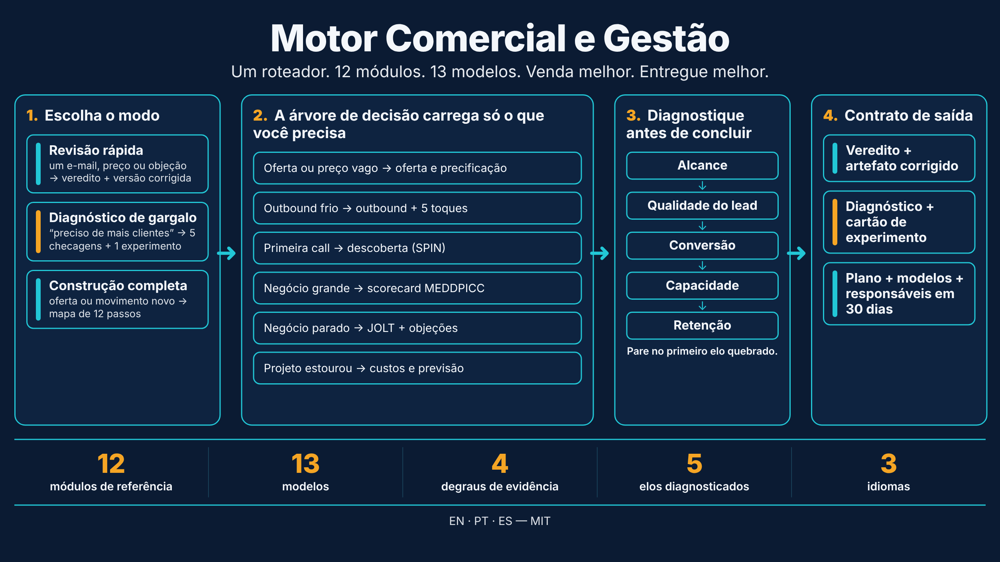
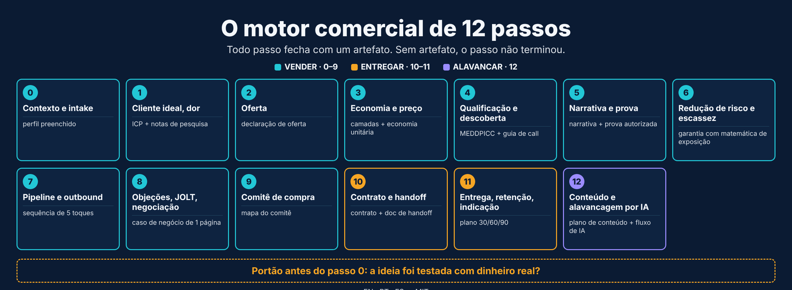
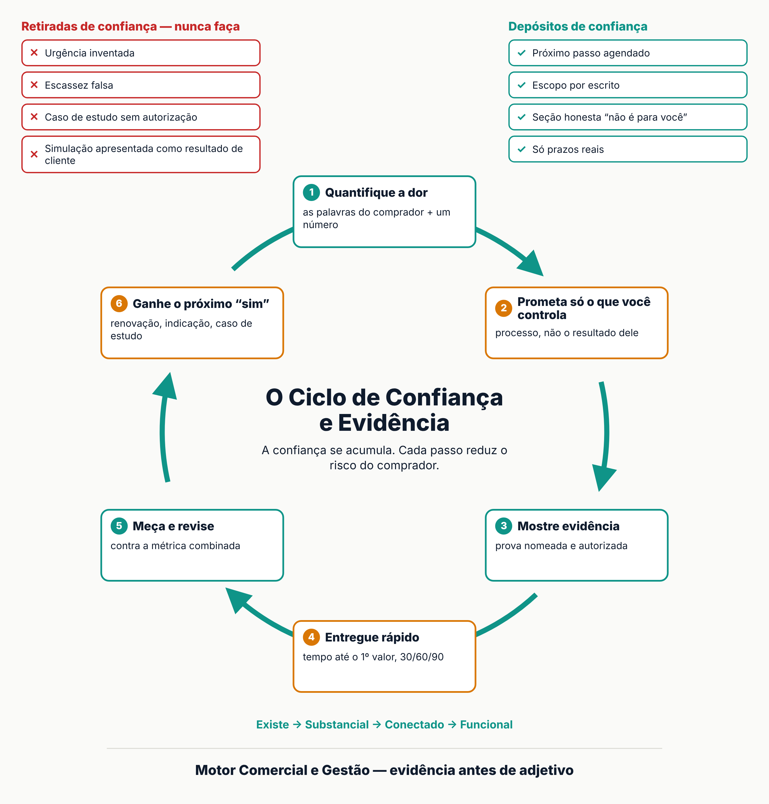

# Motor Comercial e Gestão — Skill para Claude

[English](https://github.com/C48H74/commercial-engine-and-delivery) · **Português** · [Español](https://github.com/C48H74/motor-comercial-y-gestion-es)



Skill para o Claude voltada a negócios B2B de ciclo complexo. Cobre duas frentes ligadas: **vender** (oferta, preço, outbound, descoberta, qualificação, negociação) e **entregar** (escopo, prazo, custo, risco, status). A frente comercial promete; a de entrega cumpre. Usar uma sem a outra quebra o negócio.

| Idioma | Repositório | Nome da skill |
|---|---|---|
| English (principal) | [`commercial-engine-and-delivery`](https://github.com/C48H74/commercial-engine-and-delivery) | `commercial-engine-and-delivery` |
| Português | [`motor-comercial-e-gestao-pt`](https://github.com/C48H74/motor-comercial-e-gestao-pt) | `motor-comercial-e-gestao-pt` |
| Español | [`motor-comercial-y-gestion-es`](https://github.com/C48H74/motor-comercial-y-gestion-es) | `motor-comercial-y-gestion-es` |

As três versões têm a mesma estrutura e o mesmo conteúdo. O inglês é a fonte; português e espanhol são traduções.

## O que cobre

| Parte | Conteúdo |
|---|---|
| `SKILL.md` | Roteador: regras que valem mais que todas as outras, 3 modos (revisão rápida, diagnóstico de gargalo, construção completa), tabela situação → módulo, contrato de saída |
| `references/` (12) | Evidência e perfil, oferta e precificação, metodologias de venda (SPIN, MEDDPICC, JOLT, Challenger), outbound e objeções, motor de 12 passos, entrega de projetos (PMBOK 7), custos e previsão (valor agregado, PERT), risco, pessoas e rituais, normas e benchmarks (ISO 21502, ISO 31000, PMI Pulse), arquitetura do motor, validação e negociação |
| `templates/` (13) | Perfil do negócio, roteiro de validação de ideia, roteiro de venda consultiva, roteiro de negociação integrativa, proposta e garantia, cartão de experimento, plano 30/60/90, termo de abertura, relatório de status, matriz RACI, registro de riscos, roteiro de kickoff, checklist de anti-padrões |
| `scripts/` (2) | Validador de estrutura e validador de frontmatter YAML (Node.js) |



Toda afirmação precisa de fonte, todo fato ausente vira `[a preencher]` e toda entrega declara até que degrau da escada de evidência chegou.



## Instalação

**App/web do Claude:** baixe este repositório em ZIP e envie na área de skills da sua conta.

**Claude Code:**

```bash
git clone https://github.com/C48H74/motor-comercial-e-gestao-pt.git ~/.claude/skills/motor-comercial-e-gestao-pt
```

## Uso

> Use a skill motor-comercial-e-gestao-pt para revisar a oferta e o preço do meu [descreva o negócio].

A skill pergunta primeiro o que falta (o mínimo do perfil do negócio) e devolve um veredito, o artefato corrigido ou um diagnóstico com um cartão de experimento, e fecha com **avançar / corrigir / descartar**.

Valide o pacote depois de editá-lo:

```bash
node scripts/validar_skill.mjs .
npm install yaml && node scripts/validar_yaml.mjs .
```

## Fontes e limites

Síntese de métodos e normas públicos: PMBOK Guide 7ª edição (PMI), SPIN Selling (Rackham), MEDDPICC, *The Challenger Sale* (Dixon, Adamson), *The JOLT Effect* (Dixon), ISO 21502:2020, ISO 31000:2018, PMI Pulse of the Profession e falas de praticantes como Rony Meisler e Alfredo Soares.

Nem tudo foi conferido na fonte primária. Itens marcados como **não verificado** ou "segundo o autor" não devem ser citados como fato; a seção *Limites conhecidos* do `SKILL.md` lista o que continua em aberto. As cláusulas ISO foram sintetizadas de apresentações de terceiros, e a referência 12 vem de um compilado de vídeos não verificado.

Conteúdo educativo. Não substitui orientação jurídica, contábil ou fiscal.

## Licença

[MIT](LICENSE)

## Autor

Daniel de Souza Paixão — [LinkedIn](https://www.linkedin.com/in/daniel-paixao-b5988230)
